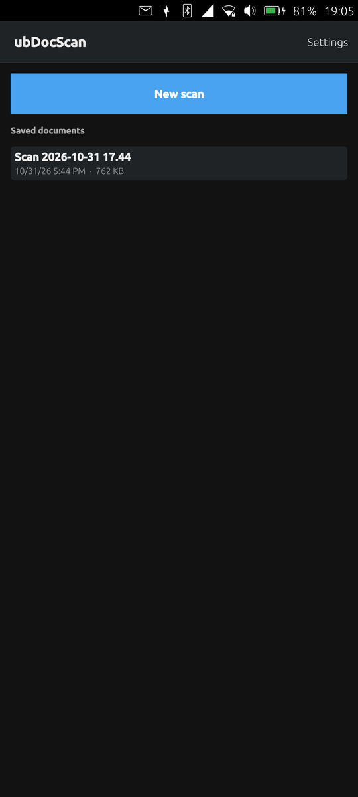

# ubDocScan


A document scanner for Ubuntu Touch: photograph pages with the camera,
straighten them, recognise the text and save them as a searchable PDF.

## Screenshots

| Start page |
| :---: |
|  |

## Features

- **Scan with the camera** — tap to focus, flash on/off. An empty document
  opens the camera right away.
- **Import photos** from the gallery or the file manager (Content Hub).
- **Straighten pages** — drag the four corners of the frame onto the page
  corners; the page is cut out and perspective-corrected (up to 3508 px, A4
  at 300 dpi). *Whole photo* uses the full picture.
- **Filters** — colour, grey (contrast stretched) or black & white (adaptive
  threshold, good for text under uneven light). The last choice is remembered.
- **Multi-page documents** — tap a page to edit its corners and filter again,
  rotate it, move it earlier/later or delete it. Pages stay when you leave
  the document and are only removed by *Save* or *Discard*.
- **OCR → searchable PDF** — Tesseract 4.1 recognises the text and the PDF
  gets an invisible text layer over each page image, so it can be searched
  and text copied from it. OCR languages: English, German, French, Spanish,
  Italian, several at once. OCR can be switched off for an image-only PDF.
- **Saved documents** — PDFs are stored in `~/Documents`, so the file manager
  and other apps find them directly. The start page lists the PDFs there with
  date and size; open or share one with another app (document viewer,
  messenger), rename, delete.
- **Multilanguage** — English, German, French, Spanish and Italian. The app
  follows the phone's language; *Settings → Language* picks a fixed one,
  applied at once.
- **Dark mode** — *Settings → Appearance*: *Like the phone* follows the
  Lomiri theme (and switches along when it changes), or *Light* / *Dark*.

## Requirements

- [Clickable](https://clickable-ut.dev) 8.7 or newer, with Docker
- An Ubuntu Touch device in developer mode, reachable over ADB (the click
  targets the `ubuntu-sdk-20.04` framework, which 24.04 still ships)

Tesseract, Leptonica and the language models come from the Ubuntu 20.04
archive inside the Clickable container; nothing needs to be installed on the
host.

## Build and install

```bash
clickable --arch arm64          # build, install and launch on the phone
```

Or step by step:

```bash
clickable build      # produces build/aarch64-linux-gnu/app/*.click
clickable install
clickable launch
clickable logs
```

Kill a running instance before installing, otherwise the old version keeps
running: `adb shell pkill -9 ubdocscan; clickable install && clickable launch`

The first build installs the Tesseract packages from `clickable.yaml` into a
cached container image.

## Layout

```
CMakeLists.txt            Build; installs the OCR models and pdf.ttf
clickable.yaml            arm64 / ubuntu-sdk-20.04, Tesseract packages, bundled libraries
manifest.json             Click metadata
ubdocscan.apparmor        Policy groups camera, content_exchange(_source); write access to ~/Documents
qml.qrc                   QML is compiled into the binary

src/main.cpp              Entry point, logging, QML context properties
src/scansession.*         The pages of the current scan, processing and export jobs ("Session")
src/pageprocessor.*       Perspective correction and filters
src/pdfexporter.*         Searchable PDF (Tesseract) and image-only PDF (QPdfWriter)
src/documentlibrary.*     Saved PDFs: list, rename, delete ("Library")
src/languagemanager.*     UI language (phone or chosen) and OCR language list ("Language")
src/systemtheme.*         Whether the phone uses a dark Lomiri theme ("SystemTheme")

qml/main.qml              Window, colours, settings, page stack, overlays
qml/HomePage.qml          Saved documents, start/continue a scan
qml/DocumentMenu.qml      Open/share, rename, delete a document
qml/ScanPage.qml          Pages of the current scan, add/save/discard
qml/PageThumbnail.qml     One page in the grid
qml/PageMenu.qml          Edit, rotate, move, delete a page
qml/CameraPage.qml        Viewfinder and shutter
qml/CropPage.qml          Scan frame and filter for one photo
qml/CornerHandle.qml      Draggable frame corner
qml/ScanFrame.qml         Frame outline with the outside dimmed
qml/FilterChoice.qml      Colour / grey / black & white
qml/ExportPage.qml        Title, OCR on/off and languages, save
qml/OcrLanguageChoice.qml OCR language check boxes
qml/SettingsPage.qml      Language and appearance
qml/LanguageChoice.qml    UI language selection
qml/AppearanceChoice.qml  Light / dark / like-the-phone selection
qml/ImportPicker.qml      Content Hub: get a photo
qml/SharePicker.qml       Content Hub: hand a PDF to another app
qml/AppHeader.qml         Page title bar
qml/AppLabel.qml          Label in the theme's text colour
qml/AppField.qml          TextField in the theme's field colours
qml/BusyOverlay.qml       Blocks input while a page or PDF is processed
qml/Note.qml              Short notes at the bottom
i18n/ubdocscan_*.ts       Translations
i18n/translate.py         Fills the translations (see below)
```

## Translations

All user-visible texts are marked with `qsTr()` (QML) or `tr()` (C++).
CMake compiles every `i18n/ubdocscan_<lang>.ts` and embeds it. English is the
source language; its file only holds the plural forms (`%n page(s)`).

After changing texts, refresh the files with `lupdate` from the Clickable
container and fill them:

```bash
LUPDATE="docker run --rm -u $(id -u):$(id -g) -v $PWD:/p -w /p \
  clickable/amd64-20.04-arm64:latest /usr/lib/qt5/bin/lupdate -no-obsolete \
  -locations relative src/*.cpp qml/*.qml"
$LUPDATE -ts i18n/ubdocscan_de.ts i18n/ubdocscan_fr.ts i18n/ubdocscan_es.ts i18n/ubdocscan_it.ts
$LUPDATE -pluralonly -ts i18n/ubdocscan_en.ts
python3 i18n/translate.py      # lists any text still missing
```

To add a UI language, add it to `kLanguages` in `src/languagemanager.cpp`
(with its Tesseract model), to `UBDOCSCAN_OCR_LANGUAGES` in
`CMakeLists.txt`, to `dependencies_host` in `clickable.yaml`
(`tesseract-ocr-<code>`), and its texts to `translate.py`.

## Data on the phone

| Path | Content |
|---|---|
| `~/Documents/*.pdf` | Saved documents (the start page lists every PDF there) |
| `~/.local/share/ubdocscan/ubdocscan.log` | App log (also in the journal) |
| `~/.cache/ubdocscan/` | Photos and pages of the current scan |
| `~/.config/ubdocscan/ubDocScan.conf` | Language, appearance, OCR choice, filter |

## Platform notes

- **Writing to `~/Documents`.** A confined app may normally only write to
  its own folders. `ubdocscan.apparmor` adds `read_path` / `write_path` for
  `~/Documents` only. These keys are reserved: click-review reports them as
  *NEEDS REVIEW*, so `clickable.yaml` sets `ignore_review_errors`.
  Sideloading works; publishing to the OpenStore would need manual review.
- **Qt 5.12 only** (`ubuntu-sdk-20.04`): `import QtQuick 2.12`,
  `QtMultimedia 5.12`, `Connections { onSignal: ... }`.
- **Bundled libraries.** A 24.04 phone has no Tesseract and newer versions of
  some of its dependencies, so `install_lib` in `clickable.yaml` copies
  libtesseract, liblept and the 20.04-only libraries (libarchive, nettle 7,
  libtiff 5, libwebp 6, libgif, libjbig, libopenjp2) into the click.
- **Tesseract and the C locale.** Qt switches `LC_NUMERIC` to the phone's
  locale; `main.cpp` sets it back to `C`, as Tesseract reads its models with
  the C library.
- **`QT_QUICK_CONTROLS_STYLE=Default`** is set in `main.cpp`, so the stock
  controls use the app's palette in both themes. Use `AppLabel` / `AppField`
  instead of bare `Label` / `TextField`.
- **The Content Hub picker** is a Lomiri toolkit component; it is created on
  first use so the toolkit does not slow down the start.

## Debugging

```bash
clickable logs
adb shell 'journalctl --user -f | grep aa-exec'
adb shell 'dmesg | grep ubdocscan | grep DENIED'      # AppArmor denials
```

## License

See `LICENSE`.
